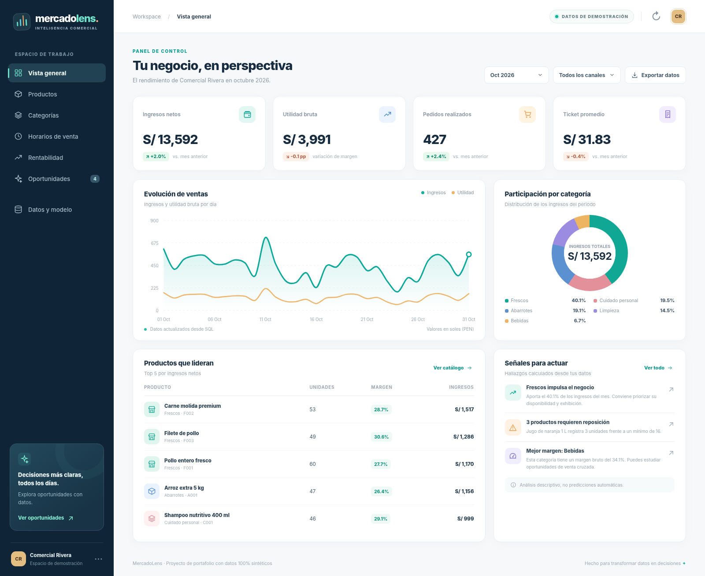
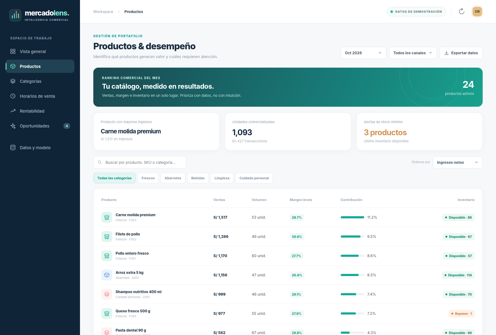
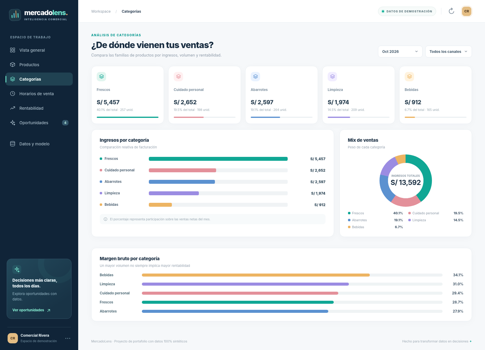
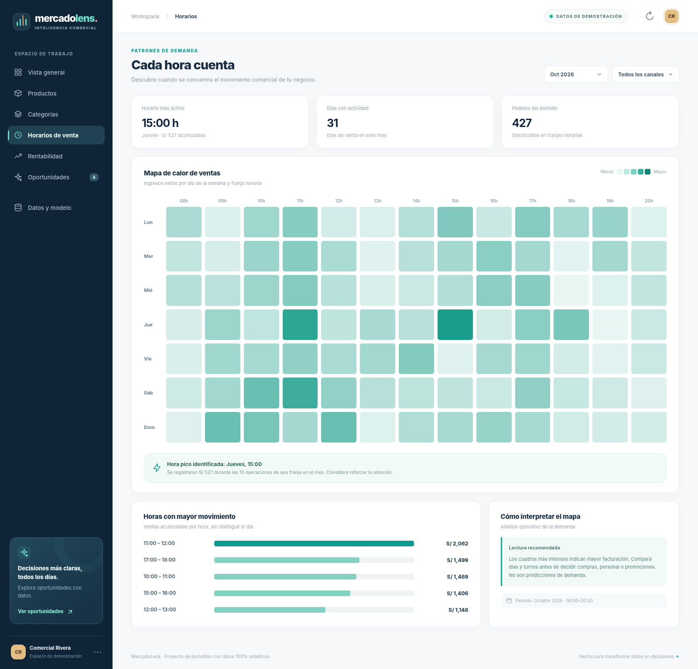
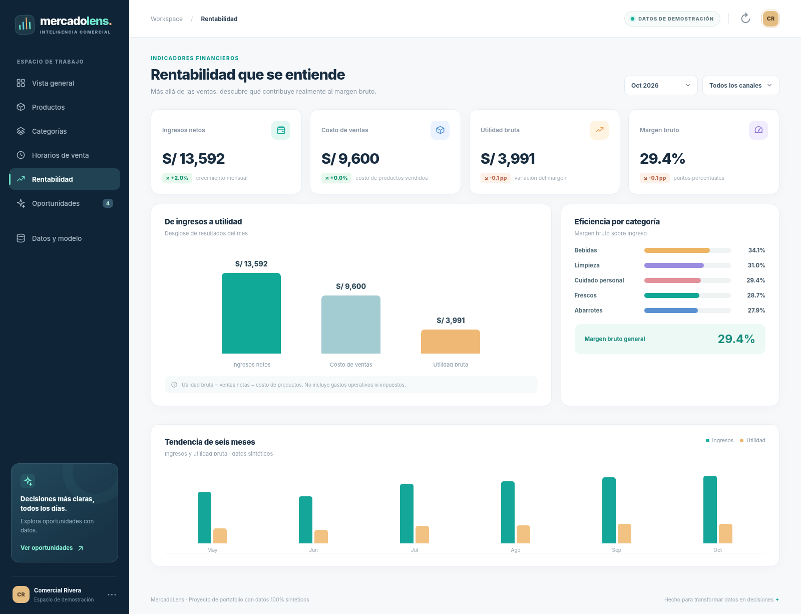
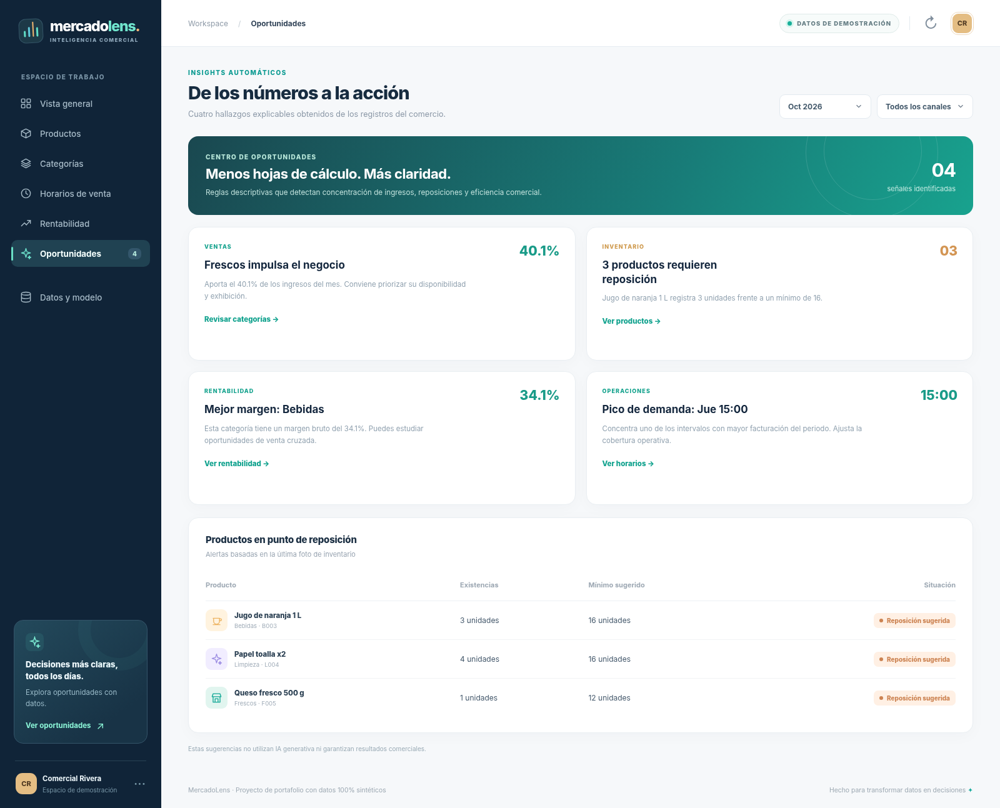
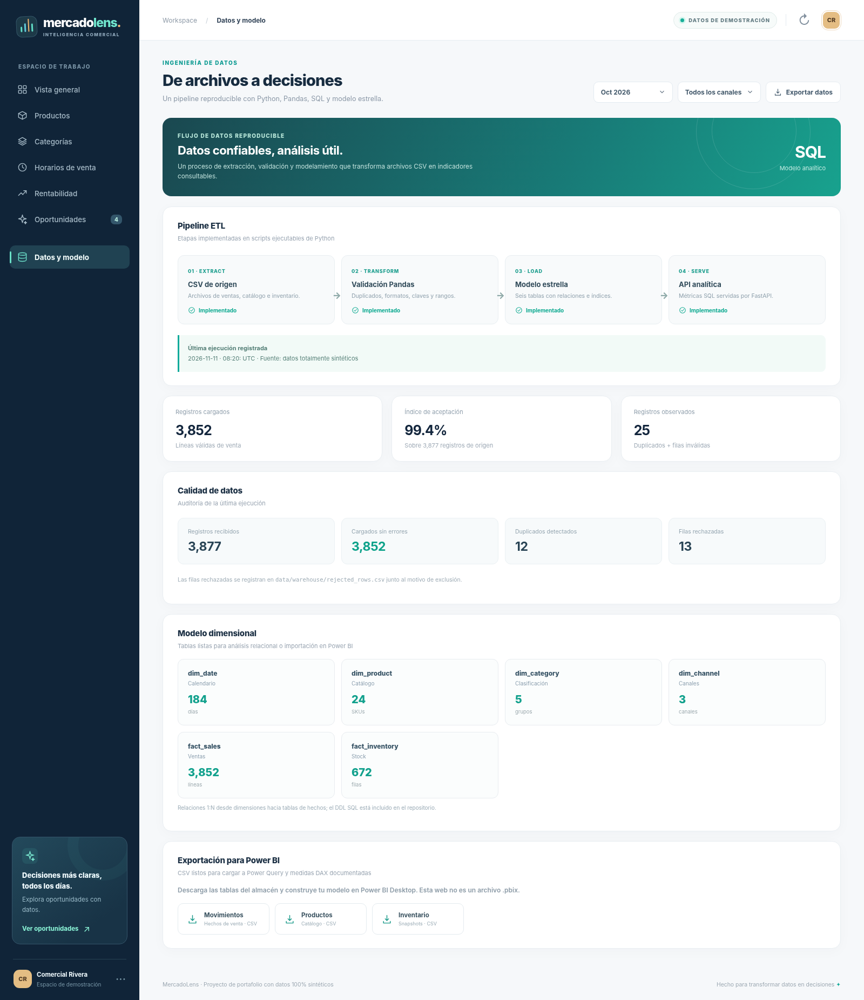
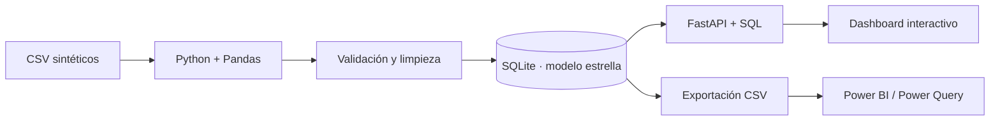

<div align="center">
  

  <p><strong>Convierte movimientos de venta en decisiones comerciales más claras.</strong></p>
  <p>Python · Pandas · SQL · SQLite · FastAPI · JavaScript · Power BI-ready</p>
  <p><sub>Analítica comercial · Comercio minorista ficticio · Datos 100% sintéticos · Ejecución local</sub></p>
</div>

---

## 📊 Vista previa



**MercadoLens** es una aplicación de analítica comercial para pequeñas empresas. Transforma archivos CSV de ventas e inventario en un modelo estrella SQL y presenta indicadores interactivos para detectar patrones, comparar categorías, controlar márgenes y anticipar necesidades de reposición mediante reglas descriptivas.

El escenario de ejemplo representa a **Comercial Rivera**, un comercio ficticio de abarrotes y alimentos en Perú, con transacciones sintéticas entre mayo y octubre de 2026. Las capturas provienen de **la interfaz web implementada**, renderizada con agregaciones del almacén SQL; no son imágenes de un informe de Power BI.

## ✨ Funciones principales

| Módulo | Qué permite analizar |
|---|---|
| **Vista general** | Ingresos netos, utilidad bruta, pedidos, ticket promedio, crecimiento y tendencias diarias |
| **Productos** | Ranking, búsqueda, filtros, unidades, márgenes, inventario y alertas de stock |
| **Categorías** | Participación en ventas, ingresos comparados y márgenes por familia |
| **Horarios** | Mapa de calor de ventas por día/hora, horas pico y concentración de demanda |
| **Rentabilidad** | Costo de mercadería, utilidad bruta, margen y comparativos mensuales |
| **Oportunidades** | Reglas explicables para detectar líderes de venta, riesgo de reposición y eficiencia |
| **Datos y modelo** | Pipeline ETL, auditoría de calidad, tablas dimensionales y exportaciones CSV |

### Más pantallas

| Catálogo y stock | Rendimiento por categoría |
|:--:|:--:|
|  |  |
| **Mapa de calor por horarios** | **Análisis de rentabilidad** |
|  |  |
| **Oportunidades comerciales** | **Pipeline y modelo de datos** |
|  |  |

## 🧩 Cómo funciona



- **ETL real:** lectura, tipificación, comprobaciones, eliminación de duplicados, rechazo de filas inválidas y carga dimensional.
- **Indicadores calculados en SQL:** el frontend consume la API y no contiene cifras comerciales fijas.
- **Datos de demostración reproducibles:** el generador usa una semilla definida; puedes modificarlo sin infraestructura externa.
- **Persistencia SQLite:** tablas de hechos/dimensiones e historial de auditoría del proceso de carga.
- **Power BI-ready:** CSV de seis tablas, documentación de relaciones, plantillas DAX y ejemplo Power Query. **No se incluye archivo `.pbix`.**

## 🚀 Ejecución local

**Requisitos:** Python 3.11 o superior, `pip` y un navegador web. No necesitas Node.js, Supabase ni cuentas de terceros para ejecutar el dashboard.

Desde la raíz del repositorio:

```bash
# 1. Crear y activar un entorno virtual (Windows / PowerShell)
py -m venv .venv
.venv\Scripts\Activate.ps1

# En macOS/Linux puedes usar:
# python3 -m venv .venv && source .venv/bin/activate

# 2. Instalar dependencias
pip install -r backend/requirements.txt

# 3. (Opcional) Volver a generar los datos ficticios y el almacén
python scripts/generate_demo_data.py
python scripts/build_warehouse.py

# 4. Iniciar la aplicación
python -m uvicorn backend.app.main:app --reload --port 8000
```

Abre **http://127.0.0.1:8000** para explorar el dashboard. La documentación de API está en **http://127.0.0.1:8000/docs**. Se incluye una copia precargada de SQLite, por lo que la regeneración del paso 3 es opcional.

**Si PowerShell bloquea la activación:** puedes ejecutar directamente `.venv\Scripts\python.exe -m pip install -r backend/requirements.txt` y `.venv\Scripts\python.exe -m uvicorn backend.app.main:app --port 8000` sin activar el entorno.

## 📁 Estructura del repositorio

```text
MercadoLens/
├── backend/
│   ├── app/                  # FastAPI + consultas SQL
│   ├── tests/                # Pruebas de lógica y API
│   └── requirements.txt
├── frontend/                 # Dashboard responsive (HTML, CSS y JS)
├── scripts/
│   ├── generate_demo_data.py # Datos sintéticos deterministas
│   ├── build_warehouse.py    # Pipeline ETL con Pandas
│   └── export_powerbi.py     # Exportador para Power BI
├── sql/                      # DDL del modelo estrella + consultas de ejemplo
├── data/
│   ├── raw/                  # Datos fuente sintéticos
│   ├── warehouse/            # Base SQLite precargada + filas rechazadas
│   └── powerbi/              # 6 CSV del modelo dimensional
├── powerbi/                  # Guía, relaciones, DAX y Power Query M
├── docs/                     # Arquitectura, diccionario y screenshots reales
└── .github/workflows/ci.yml # Verificaciones automáticas
```

## 📈 Power BI y análisis SQL

Para preparar los CSV desde el almacén:

```bash
python scripts/export_powerbi.py
```

Luego importa las tablas desde `data/powerbi/` a Power BI Desktop, relaciona dimensiones y hechos como se indica en [la guía de integración](powerbi/README.md) y copia las [medidas DAX propuestas](powerbi/DAX_MEASURES.md). También se adjuntan [consultas SQL reproducibles](sql/analytics_queries.sql).

Este proyecto **no afirma un despliegue en Power BI Service ni la creación de un `.pbix`**. El dashboard mostrado funciona en el navegador con FastAPI.

## ✅ Validaciones

Se incluyen seis pruebas cortas para verificar: consistencia de métricas SQL, conciliación entre canales, integridad y deduplicación del ETL, parámetros de API, exportación CSV y entrega de recursos web.

```bash
pip install -r backend/requirements-dev.txt
python -m pytest backend/tests -q
```

El JavaScript se puede comprobar con `node --check frontend/app.js` (Node.js solo necesario para esta validación opcional). El repositorio incorpora GitHub Actions para regenerar el dataset y ejecutar estas comprobaciones en cada push.

## 🔎 Decisiones y límites

- **Indicadores financieros:** ingresos y utilidad son métricas **brutas** a nivel de mercancía; no incorporan sueldos, alquiler, impuestos o gastos administrativos.
- **Sin datos reales:** todas las personas, nombre del comercio, inventario, productos y transacciones son ficticios. El ETL incluye deliberadamente filas inválidas para demostrar controles de calidad.
- **Alcance acotado:** no hay autenticación, multiusuario, carga web de CSV externos, predicción estadística ni despliegue público. Está diseñado para demostraciones y ejecución local.
- **Capturas verificables:** las siete capturas muestran vistas del dashboard construido y datos obtenidos de la misma lógica de negocio; pueden regenerarse con una sesión local de navegador.

Más información: [Arquitectura](docs/ARCHITECTURE.md) · [Diccionario de datos](docs/DATA_DICTIONARY.md) · [Guía Power BI](powerbi/README.md).

---

## Autor y licencia

**Fanaker Labs** · Proyecto personal de analítica comercial, ingeniería de datos e indicadores de negocio. Código bajo licencia [MIT](LICENSE).
