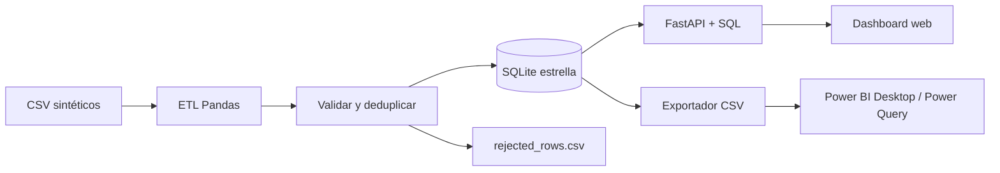
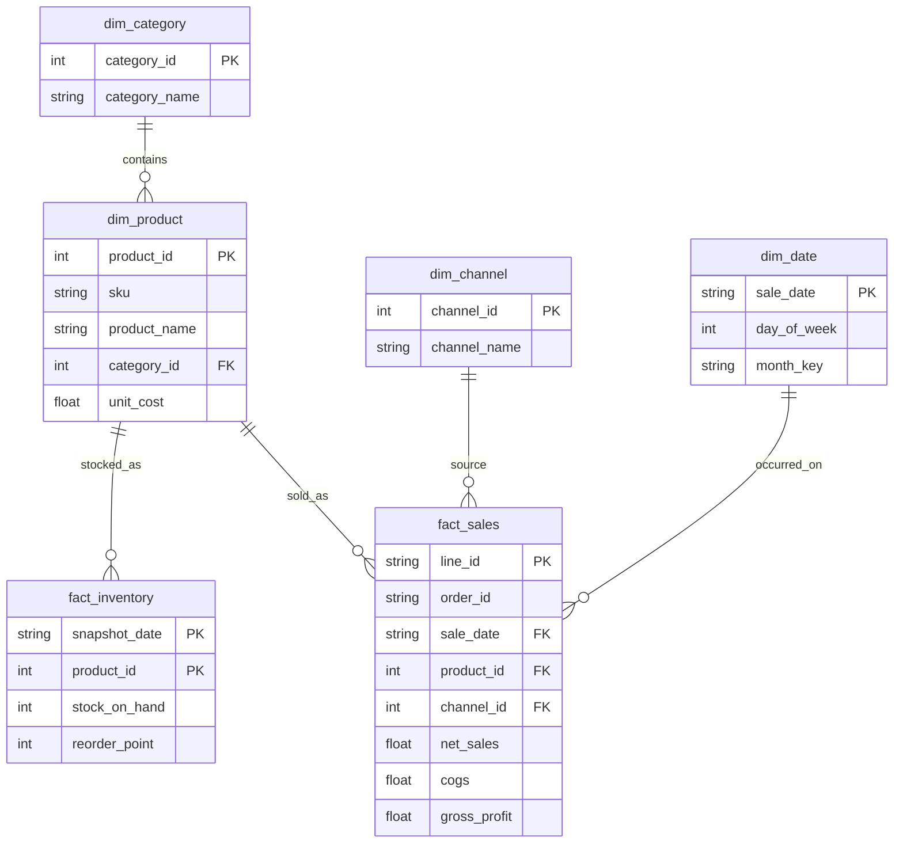

# Arquitectura técnica

MercadoLens es una app local de analítica comercial con **fuente sintética determinista**, pipeline ETL en Pandas, almacén SQLite, FastAPI y dashboard HTML/CSS/JavaScript. No necesita servicios cloud ni credenciales.

## Modelo de datos

## Reglas de negocio

- Cada línea de venta tiene un ID único. Los duplicados se excluyen de la carga y quedan registrados.
- `gross_sales = quantity * unit_price`.
- `net_sales = quantity * (unit_price - discount)`.
- `cogs = quantity * unit_cost`.
- `gross_profit = net_sales - cogs` y `gross_margin = gross_profit / net_sales`.
- El ticket promedio divide ventas netas por **pedidos únicos**.
- Alertas de reposición se disparan si stock `<= reorder_point`, a partir de la última instantánea válida del periodo.
- Se consultan agregaciones SQL en cada cambio de mes o canal. La interfaz no conserva datos de clientes, ni implementa login o multiempresa.
- Meses habilitados: mayo a octubre de 2026; tres canales comerciales.

## Endpoints API

| Método | Endpoint | Descripción |
|---|---|---|
| GET | `/api/health` | Estado del almacén |
| GET | `/api/dashboard?month=2026-10&channel=all` | Resumen + series + categorías + productos + horas + calidad + insights |
| GET | `/api/export/sales` | CSV sintético de hechos de venta, enriquecido con categorías |
| GET | `/api/export/products` | CSV catálogo |
| GET | `/api/export/inventory` | CSV inventario |
| GET | `/docs` | Documentación Swagger de FastAPI |

`channel` acepta `all`, `Tienda física`, `WhatsApp` o `Delivery` (la URL debe codificar caracteres especiales). Un mes o canal inválido devuelve HTTP 422.

## Limitaciones intencionales de esta versión

Solo análisis descriptivo, sin forecasting ni aprendizaje automático. No hay backend de usuarios, subida de archivos desde la web, seguridad multi-tenant ni despliegue en producción. No se ha creado un archivo `.pbix`; la carpeta `powerbi/` incluye una guía y artefactos para construirlo. Los datos son de demostración y no representan ventas reales.
